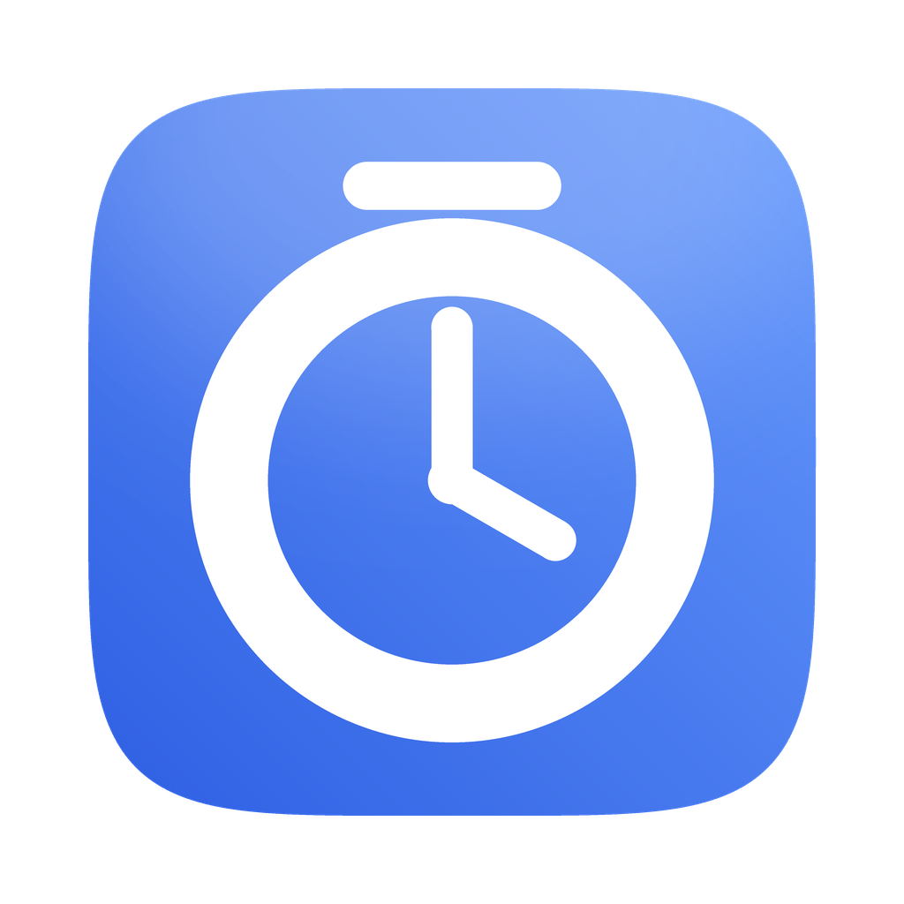
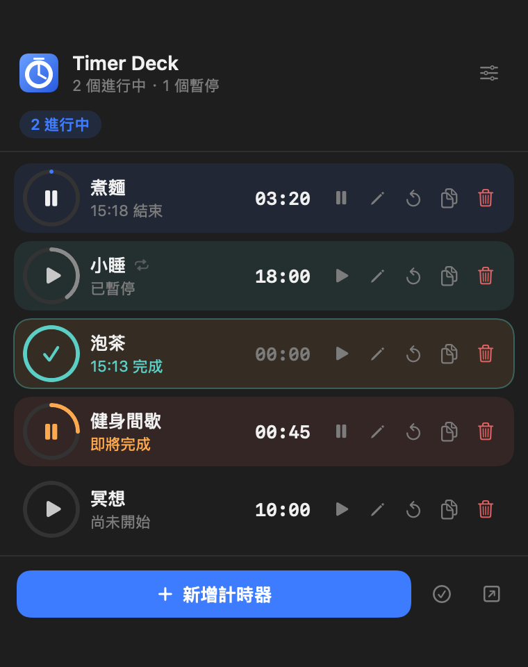
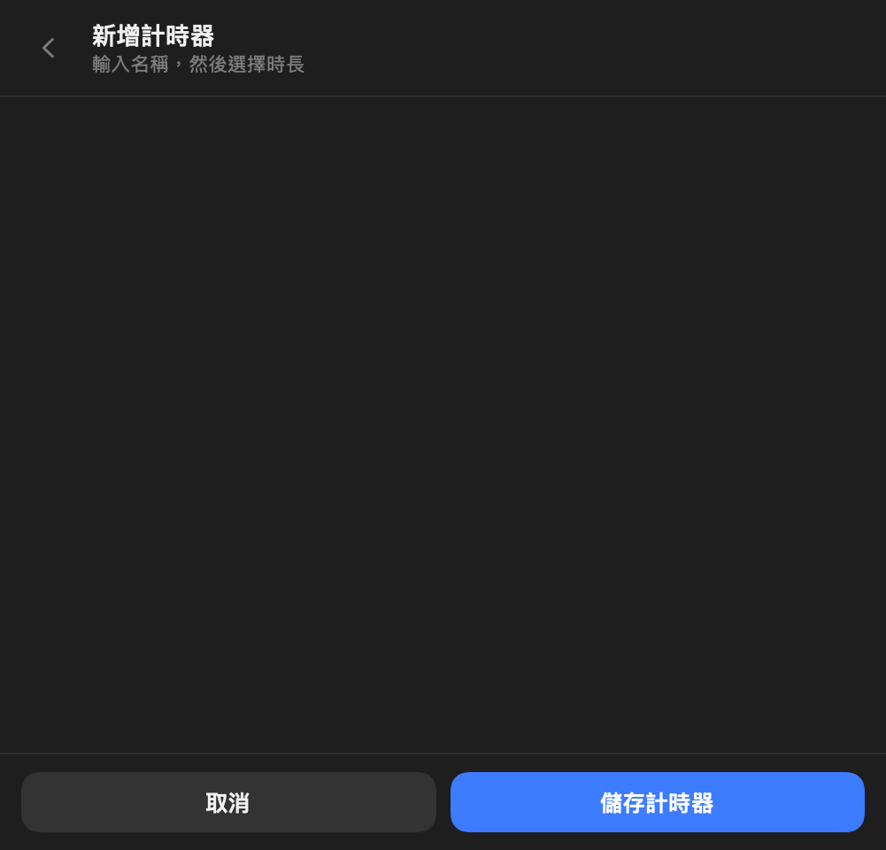
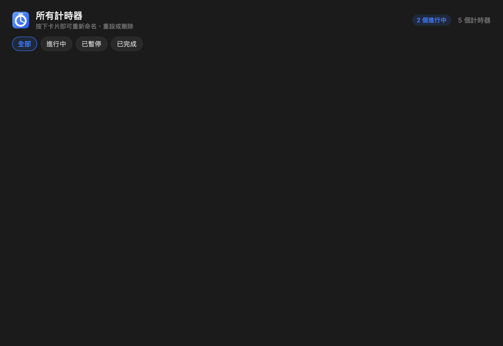
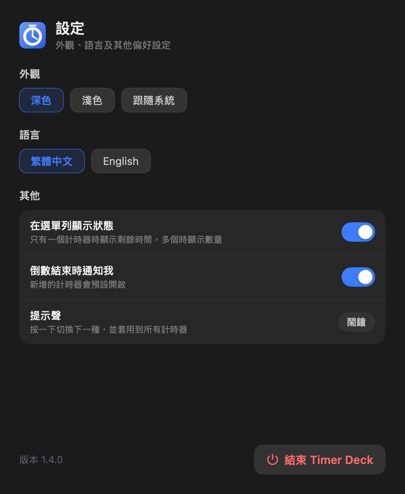

# Timer Deck

macOS 選單列計時器 —— 無需開啟視窗，隨時掌握剩餘時間。

<p align="center">
  
</p>

## 功能

- **常駐選單列** —— 不佔用 Dock，不干擾工作流程
- **多計時器並行** —— 每個計時器可獨立設定時長與提示音
- **選單列顯示剩餘時間** —— 當僅有一個計時器運行時，選單列直接顯示倒數數字（`12:34`）
- **預設計時器一鍵啟動** —— 常用時長可預先儲存，新增後自動開始倒數
- **右鍵選單** —— 右鍵點擊選單列圖示，即可開啟儀表板、設定或退出
- **提示音可選** —— 內建四種音效（ping / chime / bell / alarm）
- **深色與淺色模式**，介面支援中英雙語
- **完全離線** —— 不連線網路，所有資料均儲存於本機

## 畫面

| 主面板 | 新增計時器 |
| :---: | :---: |
|  |  |

| 儀表板 | 設定 |
| :---: | :---: |
|  |  |

## 下載安裝

1. 前往 **[Releases](https://github.com/bassoonowlpie/timer-deck-mac/releases/latest)** 下載最新的 `TimerDeck-x.x.x-macOS.zip`
2. 解壓縮後，將 `Timer Deck.app` 拖曳至 `/Applications`（或 `~/Applications`）
3. 首次開啟時 macOS 會阻擋，請參閱下一節 👇

### ⚠️ 首次開啟：macOS 顯示「無法打開」

本應用程式未使用 Apple 付費開發者憑證簽名，因此 macOS 會出現以下提示：

> 「Apple 無法檢查『Timer Deck』是否包含惡意軟體」
> 或「Timer Deck 已損壞，無法打開」

**以下三種方法擇一即可：**

**方法 A —— 系統設定（最直觀）**

`系統設定` → `私隱與保安` → 捲動至下方「保安」區塊 → 找到 Timer Deck 的提示 → 點按 `仍要開啟` → 再次確認。

**方法 B —— 右鍵開啟（最快速）**

於 Finder 對 `Timer Deck.app` 點按**右鍵** → 選擇 `打開` → 在彈出視窗再點按一次 `打開`。
之後即可正常雙擊開啟。

**方法 C —— 終端機（最直接）**

```bash
xattr -cr "/Applications/Timer Deck.app"
```

> **原因說明：** macOS 會對所有自網路下載的應用程式檢查「公證（notarization）」，而公證需具備 Apple 每年 US$99 的開發者帳號。本工具為免費分享，因此採用本機簽名。上述三種方法皆僅需執行一次。

## 系統需求

- macOS 13 Ventura 或以上版本
- **Apple Silicon（M1 / M2 / M3 / M4）**

> 目前僅編譯 arm64 架構，Intel Mac 暫不支援，可自行由原始碼編譯（見下節）。

## 由原始碼編譯

僅需 Xcode Command Line Tools，無需安裝完整 Xcode：

```bash
xcode-select --install        # 若尚未安裝
git clone https://github.com/bassoonowlpie/timer-deck-mac.git
cd timer-deck-mac
./build.sh
open ".build/Timer Deck.app"
```

編譯產物置於 `.build/`（隱藏目錄）—— 如此 Spotlight 便不會索引到第二個 `Timer Deck.app`，可避免啟動器出現重複圖示。

## 資料存放位置

| 內容 | 路徑 |
| --- | --- |
| 計時器資料 | `~/Library/Application Support/TimerDeck/deck.json` |
| 偏好設定 | `~/Library/Preferences/com.bassoonowlpie.timerdeck.plist` |

如需備份或移轉至新機，複製這兩個檔案即可。解除安裝則為刪除應用程式及上述兩個檔案。

## 授權

[MIT](LICENSE) —— 可自由使用、修改與再散布。

---

## English

**Timer Deck** is a lightweight menu-bar timer for macOS 13+ (Apple Silicon). Timers stay one click away, the remaining time is displayed directly in the menu bar when a single timer is active, and everything is stored locally — the app makes no network requests.

**Install:** download the latest `TimerDeck-x.x.x-macOS.zip` from [Releases](https://github.com/bassoonowlpie/timer-deck-mac/releases/latest), unzip, and drag `Timer Deck.app` into `/Applications`.

**The first launch is blocked by Gatekeeper**, because the app is ad-hoc signed rather than notarized (notarization requires a paid Apple Developer account). Fix it with any of the following:

- **System Settings** → Privacy & Security → scroll to the bottom → *Open Anyway*
- **Right-click** the app in Finder → *Open* → *Open* again
- **Terminal:** `xattr -cr "/Applications/Timer Deck.app"`

**Build from source:** run `./build.sh` — requires only Xcode Command Line Tools.

Licensed under the [MIT License](LICENSE).
